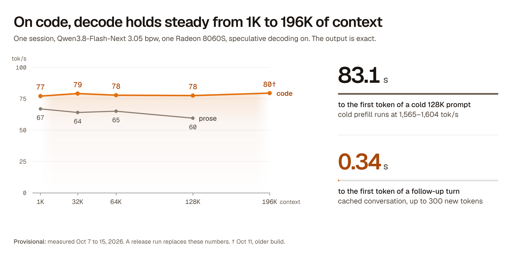

# Crucible

An inference engine for EXL3 checkpoints of Qwen3.8-Flash-Next on one AMD Strix Halo APU.

<picture>
  <source media="(prefers-color-scheme: dark)" srcset="docs/assets/crucible-hero-dark.png">
  
</picture>

Crucible runs **EXL3** checkpoints of **Qwen3.8-Flash-Next** (**Qwen 3.8 Flash Next**) on **AMD Strix Halo**:
one **Ryzen AI Max+ 395** with a **Radeon 8060S** (**gfx1151**) and 128 GB of unified memory. It uses its own
**ROCm/HIP** kernels in C++20. It does not use another engine for inference. A local OpenAI-compatible server
gives chat, streamed responses, function calls, and exact speculative decoding. This is research software for
one GPU architecture, not a general model backend or a production service.

[Progress report](https://srv.jaedyn.me/strix-halo-engine-optimization/index.html) · [Measurements](docs/BENCHMARKS.md) ·
[Architecture](docs/ARCHITECTURE.md) · [Build guide](docs/BUILD.md)

## What it is like to use

The table shows one session on the 3.05 bpw pack, which is the pack for daily use. Speculative
decoding (MTP) is on, as in daily use. A cold prompt has no part in the cache.

| Context | First token, cold prompt | Prefill | Decode, code | Decode, prose |
|---|---:|---:|---:|---:|
| 4K | 2.88 s ¹ | 1,443 tok/s ¹ | 77 tok/s ² | 67 tok/s ² |
| 32K | 20.5 s | 1,604 tok/s | 79 tok/s | 64 tok/s |
| 64K | 41.1 s | 1,602 tok/s | 78 tok/s | 65 tok/s |
| 128K | 83.1 s ³ | 1,565 tok/s ³ | 78 tok/s | 60 tok/s |
| 196K | not measured | not measured | 80 tok/s ⁴ | not measured |

Without a mark: first token and prefill come from the same-harness run of Oct 13 to 14, as the median of the cold requests. Decode comes from one session on Oct 13. Both use the release build of Oct 13.\
¹ Measured on Oct 7 with an older build (Oct 6), in the same harness. The 4K requests start at the idle GPU clock.\
² Decode at 1K context.\
³ A prompt of about 130,000 tokens.\
⁴ Measured on Oct 11 with an older build, code only. No cold run used this length.

**Four sessions at once:** 130 tok/s in total at 32K and 124 tok/s at 128K on
code, 115 tok/s and 111 tok/s on prose (Oct 13). Eight sessions gave
148 tok/s in total at 32K (Oct 12).

**A follow-up turn in a cached conversation:** the first token comes after 0.34 s for up to 300
new tokens, 0.50 s for 300 to 1,000, 1.14 s for 1,000 to 3,000, and
2.22 s for 3,000 to 10,000 new tokens (medians of real turns, Oct 13 to 15).

- **The cache makes later turns fast.** A later turn pays only for its new tokens: about
  0.19 s plus about 1 ms for each new token. A long context costs its
  cold prefill only once. An optional disk tier restored a conversation of 87,867 tokens in
  0.55 s (Oct 15).
- **Decode stays almost flat with context.** One session decodes at 77 to 80 tok/s on code from 1K to
  196K. The draft head predicts code better than prose, so prose decodes at 60 to 67 tok/s.
- **The output is exact.** Speculative decoding changes the speed, not the tokens. Each speed change must pass
  bitwise-equal gates before it merges.
- **Real use.** On one day of agent work (Oct 12, 2,890 turns, an older build), the median time to
  the first token was 0.52 s. One session decoded at 74.9 tok/s (median). The median
  prefill was 1,076 tok/s for turns with 1,024 or more new tokens.

How each value was measured: [measurement details](#measurement-details).

**These numbers are provisional.** They come from the development records up to 2026-10-15, not from a release
run. A release run on 2026-10-18 replaces them. Each value names its date. A value is not a measurement of a
later build.

## Same-harness comparison with Halogen and Gufo

| Engine | Version | Date | Cold 32K prefill | Cold 130K prefill | Decode after a 32K prompt |
|---|---|---|---:|---:|---:|
| Crucible | release build of 2026-10-13 (3.05 bits per weight) | 2026-10-13 | 20.5 s | 83.1 s | not measured in this run |
| Halogen | 0.16.2 | 2026-10-13 | 18.1 s | 73.3 s | not measured in this run |
| Crucible | development build of 2026-10-08 (3.05 bits per weight) | 2026-10-10 | 22.4 s | 88.3 s | 79 to 80 tok/s |
| Halogen | 0.16.2 | 2026-10-10 | 18.6 s | 75.0 s | 53 to 55 tok/s |
| Crucible | development build of 2026-10-06 (3.05 bits per weight) | 2026-10-07 | 22.4 s | 94.8 s | not measured in this run |
| Halogen | 0.16.2 | 2026-10-07 | 18.2 s | 74.0 s | not measured in this run |
| Gufo | 0.9.0 (GGUF UD-Q4_K_XL, MTP on) | 2026-10-07 | 23.8 s | 97.7 s | not measured in this run |

**Thank you to the authors of Halogen and of Gufo.** Their engines run on the same hardware with
their own weight formats, and they made this comparison possible.

How these runs were made: one machine, one request client for all engines of a run, synthetic prompts, a fresh
nonce in each prompt so that every prefill is cold, and greedy decoding. Each engine runs the checkpoint and the
flags that its own authors recommend. The engine and the weight format differ, so a rate difference is not an
engine-only comparison. The 2026-10-07 and 2026-10-10 runs used `tools/h2h_decode.py` with thinking off. The
2026-10-13 run used a newer client with the same prompts. It measured cold prefill only. Halogen ran at about
3% higher GPU clock in the 2026-10-13 run, and at about 5% higher GPU clock in the 2026-10-10 run.
Gufo 0.9.0 ran on 2026-10-07 with its GGUF UD-Q4_K_XL pack. That run used an older Crucible build, so its
rows show that build.

Quality: the same next-token test on real sessions (2026-10-10) gives an accuracy of 0.7108 for the
3.05 bpw pack, 0.7146 for the 4.05 bpw pack, and 0.7095 for Halogen 0.16.2 with its
v2 weights. In this test, the 3.05 bpw pack is equal to Halogen v2, and the 4.05 bpw pack is slightly better.

These comparison numbers are provisional in the same way as the table above.

## What it is

- One engine for one model family and one GPU architecture. No fallback path.
- **Exact speculative decoding.** The target verifies every draft. A rejected suffix never becomes
  committed state.
- **A keyed sampling law.** A seeded request gives the same IDs at any speculation depth, and in a
  packed batch pass.
- **Measured hardware ceilings.** Most speed claims name the ceiling and the percentage of it.
  Speculative decoding and batching have no single ceiling.
- A local OpenAI-compatible HTTP frontend with chat, streaming, tools, and up to eight sessions on
  one engine.

## Quick start

### 1. Build

```sh
make
```

The build needs the [software below](#hardware-and-software). It writes `build/engine/crucible`.

### 2. Download the model

Read the [model license note](#model-license) first.

```sh
PACK=3.05bpw_h5_ng5
CKPT="$PWD/models/Qwen3.8-Flash-Next-exl3-$PACK"
hf download turboderp/Qwen3.8-Flash-Next-exl3 --revision "$PACK" --local-dir "$CKPT"
```

The supported packs are in [turboderp/Qwen3.8-Flash-Next-exl3](https://huggingface.co/turboderp/Qwen3.8-Flash-Next-exl3).
Use revision `4.05bpw_h6_ng6` for the quality pack.
Keep every tokenizer file, weight shard, n-gram table, and MTP mixer patch.

### 3. Run

```sh
python -m server "$CKPT" --engine build/engine/crucible --ctx 32768
```

The server binds to `127.0.0.1:8790`. It has no authentication. Do not expose it to a network.
Send a request from another terminal:

```sh
curl -sS http://127.0.0.1:8790/v1/chat/completions \
  -H 'Content-Type: application/json' \
  -d '{"model":"crucible","messages":[{"role":"user","content":"Say hello."}],
       "temperature":0,"max_tokens":32}'
```

The API provides `/v1/chat/completions`, `/v1/completions`, `/v1/models` and `/tokenize`.
Use `stream: true` for server-sent events. Add OpenAI `tools` definitions for function calls.
See [the server guide](server/README.md) for the options and the limits.

For direct generation without the server:

```sh
python tools/tok.py "$CKPT" encode "Write a Python function that adds two numbers." --chat > prompt.ids
build/engine/crucible gen "$CKPT" --ids-file prompt.ids --n 160 --spec 2 --ctx 4096
```

## Hardware and software

- Ryzen AI Max+ 395, Radeon 8060S (gfx1151), 128 GB shared LPDDR5X-8000.
- Linux. The tested system is Arch Linux with kernel 7.2.7 and ROCm 7.2.4.
- A C++20 HIP compiler, GNU Make, and POSIX threads. The CPU test suite needs
  GCC 14 or newer, or Clang 18 or newer.
- Python 3.12 or newer. The CPU dependencies are in `requirements-cpu.txt`.
- Enough disk space for one complete checkpoint and the build output.

The 3.05 bits-per-weight payload alone is about 84.45 GB. Use one model instance. An ordinary
discrete desktop GPU does not have enough memory for it.
The 4.05 bits-per-weight pack needs more memory than the 3.05 pack.
Set `CRUCIBLE_PLE_HOST=1` to keep the PLE n-gram table in host memory, at 32.6 GB (3.05) or
39.0 GB (4.05).

## Hardware ceilings

The test system has a Ryzen AI Max+ 395, Radeon 8060S (gfx1151), 128 GB shared LPDDR5X-8000.
Its measured ceilings are **245.5 GB/s cold reads** and **48.2 TFLOPS f16 WMMA**.
See [chip calibration](docs/CALIBRATION.md).

These rows are engine benchmarks from early October. They compare the engine with the hardware.
**Serial decode** makes one token for each forward pass, without speculative decoding. Daily use has
speculative decoding on: see [What it is like to use](#what-it-is-like-to-use).

| Workload | Measured rate | Hardware ceiling | Percent of ceiling | Runs | Date |
|---|---:|---:|---:|---:|---|
| Serial decode, 3.05 bpw | 38.79 tok/s | 53.19 tok/s | 72.9% | 2 | 2026-10-04 |
| Serial decode, 4.05 bpw | 33.71 tok/s | 45.84 tok/s | 73.5% | 2 | 2026-10-04 |
| MTP, two drafts, 3.05 bpw | 68.02 tok/s | acceptance-dependent | n/a | 1 | 2026-10-03 |
| 4,096-token prefill, 3.05 bpw | 1,566.2 tok/s | 2,310 tok/s | 67.8% | 2 | 2026-10-04 |
| 16,384-token prefill, 3.05 bpw | 1,526.9 tok/s | 2,310 tok/s | 66.1% | 2 | 2026-10-04 |
| 4,096-token prefill, 4.05 bpw | 1,511.3 tok/s | 2,289 tok/s | 66.0% | 2 | 2026-10-04 |
| 16,384-token prefill, 4.05 bpw | 1,493.1 tok/s | 2,289 tok/s | 65.2% | 2 | 2026-10-04 |
| Eight streams in total, 3.05 bpw | 104.24 tok/s | no single ceiling | n/a | 1 | 2026-10-03 |
| Eight streams in total, 4.05 bpw | 90.83 tok/s | no single ceiling | n/a | 1 | 2026-10-03 |

The serial ceiling is the weight-read ceiling: 4.615 GB of logical weight reads for each token at
3.05 bits per weight, and 5.356 GB at 4.05 bits per weight.
The prefill ceiling is an estimate for a 4,096-token prompt with EXL3 trellis decode in the current
data path.
The percentage is a model ratio. It is not a measured GPU utilization.
Prefill timing ends at the first target ID. It excludes model load, tokenization, queue time, and
HTTP transport.

## Measurement details

- **First token and prefill, 32K to 128K:** the same-harness run of 2026-10-13 to 14 with the release build of
  2026-10-13. Each value is the median of six cold requests. Prefill tok/s is the prompt tokens divided by the
  time to the first token, so it includes the server path.
- **First token and prefill at 4K:** the same harness on 2026-10-07 with a build of 2026-10-06, median of four
  requests. These requests start at the idle GPU clock.
- **Decode:** one session after a prompt of each length, on 2026-10-13 with the release build of 2026-10-13, for a
  code task and for a prose task. The 196K value is for code only, on 2026-10-11 with an earlier build. The draft
  head gives 3.3 to 3.6 accepted tokens for each forward pass on code, and
  2.4 to 2.7 on prose.
- **Four sessions:** the total rate while all four sessions decode at the same time.
- **Follow-up turns:** medians of real turns in cached conversations, from the request log of the daily engine
  (2026-10-13 to 15), by the number of new tokens. The fit of about 0.19 s plus about
  1 ms for each new token is for the engine prefill time of these turns.
- **Real use:** the turn statistics of the daily engine for 2026-10-12. They hold numbers only, no text.
- **Prefill in this source:** this source adds a faster MoE kernel pair for the 3.05 bpw pack. In A/B pairs on
  2026-10-14, with the engine profiler on, prefill went from 1,595 tok/s to 1,630 tok/s at
  32K, and from 1,547 tok/s to 1,580 tok/s at 128K. The table at the top does not include
  this gain.
- **The 4.05 bpw pack** (better quality, more weight bytes for each token): one session on 2026-10-14 decodes at
  63 / 66 / 65 tok/s on code and
  55 / 55 / 55 tok/s on prose, at 1K / 32K / 128K.
  Four sessions at 32K give 112 tok/s in total on code and
  100 tok/s on prose.

## Model license

The engine uses Apache-2.0. **The model weights use other terms.**
Both supported EXL3 packs use the Qwen Community License 1.0.
Commercial use has additional conditions.
Read [the model license note](docs/THIRD_PARTY.md#model-weights) before you download or use a pack.
The license covers the model artifacts. It does not cover this engine. This engine does not include
the weights.

## Tests

```sh
make -j2 test-cpu
```

The CPU suite builds the test and benchmark programs and runs the offline tests. It needs no GPU.
GPU checks are manual. They need the qualified machine, both checkpoints, and the gate tool
`tools/gates.py`.
See [all build and test targets](docs/BUILD.md).

## Documentation

- [Architecture](docs/ARCHITECTURE.md) and [the Flash-Next forward specification](docs/FLASHNEXT_FORWARD.md)
- [EXL3 format](docs/EXL3_FORMAT.md) and [checkpoint metadata](docs/EXL3_CHECKPOINT_METADATA.json)
- [Build and test guide](docs/BUILD.md)
- [Calibration](docs/CALIBRATION.md) and [benchmark history](docs/BENCHMARKS.md)
- [Exactness rules and gates](docs/ARCHITECTURE.md#exactness-rules)
- [Server guide](server/README.md), [OpenAI clients](docs/OPENAI_CLIENTS.md) and [session replay](docs/SESSION_REPLAY.md)
- [Third-party terms](docs/THIRD_PARTY.md)
- Progress report: [https://srv.jaedyn.me/strix-halo-engine-optimization/index.html](https://srv.jaedyn.me/strix-halo-engine-optimization/index.html)

## Limitations

- Only the named model packs and gfx1151 are qualified.
- Image input is opt-in (`--vision`). Video is not supported. There is no general model loader.
- The HTTP frontend has no authentication, no TLS, and no tenant isolation. Keep it on loopback.
- The conversation cache is opt-in. It stays in host memory, and a restart clears it, unless the optional
  disk tier (`--state-dir`) keeps it.
- Long contexts need a large amount of memory. A long-context timing is not a quality test.
- Generated tool arguments can be invalid. The server reports the error. It never runs a tool.

## License

Apache-2.0. See [LICENSE](LICENSE) and [NOTICE](NOTICE).
The ExLlamaV3 notice is in `NOTICE`.
